# Ads Marketplace Simulator

This is an Ads Marketplace simulator that contains
1. A synthetic world of users who generate activities such as visits to a website and their interactions
2. A pluggable multi-dimensional `ad-server` that contains standard modules (**Retrieval × Pacing × Bidding × Scoring × Ranking**)
3. ML models for ads ranking, marketplace dynamics
4. Automated simulation analyses

It's meant to provide a surface to experiment with what-if scenarios and mechanisms to optimize for them. It's mostly built using Antigravity and other AI tools. 

More here: https://arjunkul.com/posts/ads-marketplace/

## System Architecture


## Usage
Recommended usage: 
1. Setup Antigravity with a remote connection and point to this repo
2. Run the various simulation profiles and examine how results change as one changes the world and marketplace
3. Test new profiles, or modify the world and or marketplace systems

[[AI Generated Documentation]]

## Workspace Crates

| Crate | Path | Binary | Purpose |
|---|---|---|---|
| `world-generator` | `world-generator/` ([world-generator/src/lib.rs](world-generator/src/lib.rs)) | `world-generator` | Unified synthetic world generator containing deterministic marketplace generation (`marketplace`: 10×10 taxonomy, 50 advertisers, 1,000 shoppers, 5,000 organic items, 12,000 browsing events), `visit_generator` (preference-independent visits on Stream 1 + PST diurnal timestamps driving `AdServingTarget`), and `user_activity_oracle` (5 unique preferred categories/user on Stream 3 + `score_preference` + `UserActivityOracle` on Stream 2 supporting `world-model-v0` binary `4%/0%` and `world-model-v1` noisy hierarchical `(group, category, advertiser)` click model on Stream 4 + Stream 2). |
| `ads-ml` | `ml/` ([ml/src/lib.rs](ml/src/lib.rs)) | *(library)* | Daily JSONL impression/click log store (`ImpressionLogStore`), L2-regularized logistic regression CTR model (`Score-R1` via PyTorch worker), and pre-indexed `PreparedScorer`. |
| `ad-server` | `ad-server/` ([ad-server/src/lib.rs](ad-server/src/lib.rs)) | *(library)* | Standalone ad-server module accepting `user_id` via `serve_ads(user_id)` with explicit 5-axis strategies: Retrieval (`Retrieve-V0`), Pacing (`P0`–`P2`, `pacing-1` 24h PST intraday schedule), Bidding (`bidding-basebid`, `bidding-autobid-v0`), Scoring (`S0`–`S3`, `Score-R1`), and Ranking (`R1`–`R3`). |
| `ads-marketplace-simulation` | `simulation/` ([simulation/src/simulation.rs](simulation/src/simulation.rs)) | `ads-marketplace-simulation`, `visit-generator` | 30-day click-only CPC simulation orchestrator wiring `world-generator` (`VisitGenerator` + `UserActivityOracle`) → `AdServer` → Schema v1 JSON report (plus daily `Score-R1` training when selected), and the standalone `visit-generator` CLI. |
| `simulation-analyzer` | `simulation-analyzer/` ([simulation-analyzer/src/lib.rs](simulation-analyzer/src/lib.rs)) | `simulation-analyzer` | Automated post-run analyzer computing budget depletion milestones, overall & daily CTR, eCPM, campaign spend Gini concentration, category/advertiser rollups, and diagnostic findings. |
| `sim-agent` | `sim-agent/` ([sim-agent/src/agent.rs](sim-agent/src/agent.rs)) | `sim-agent` | Autonomous 30-day simulator runner, ledger auditor, automated analyzer, JSON/CSV exporter, and deterministic pure-Rust dual-panel SVG budget plotter. |
| `ads-simulator-dashboard` | `dashboard/` ([dashboard/src/server.rs](dashboard/src/server.rs)) | `ads-simulator-dashboard` | Interactive web dashboard and HTTP/1.1 API featuring the Component Interaction Flowchart, 12-piece catalog, live Ad-Server sampler, Automated Simulation Analyzer view, live 5-axis runner, and offline `--export-dir` static bundles. |

## Quickstart

Requires Rust 1.88+ (Edition 2024).

### 1. Run workspace tests
```sh
cargo test --workspace --locked
```

### 2. Generate synthetic marketplace data
```sh
cargo run --release --locked -p world-generator -- --seed 42 --output-dir /tmp/ads-cpc
```

### 3. Run the standalone user-independent visit generator against `ad-server` (R1)
```sh
cargo run --release --locked --bin visit-generator -- \
  --marketplace /tmp/ads-cpc/marketplace.json \
  --output /tmp/ads-cpc/slates.json \
  --seed 42 --ranker R1 --slate-size 20 --requests 25
```

### 4. Run the 30-day CPC simulation & auto-analyze it
```sh
cargo run --release --locked -p ads-marketplace-simulation -- \
  --marketplace /tmp/ads-cpc/marketplace.json \
  --output /tmp/ads-cpc/simulation.json \
  --seed 42 --campaign-budget-cents 10000 --cpc-cents 100 --impressions 1000000 --ranker R1 --slate-size 20

cargo run --release --locked -p simulation-analyzer -- \
  --report /tmp/ads-cpc/simulation.json \
  --output /tmp/ads-cpc/analysis.json
```

### 5. Run `sim-agent` (simulate + audit + auto-analyze + plot 30-day budget spend)
```sh
cargo run --release --locked -p sim-agent -- \
  --seed 42 --campaign-budget-cents 10000 --cpc-cents 100 --impressions 1000000 --ranker R1 \
  --output-dir output/sim-agent
```
Outputs written atomically to `output/sim-agent/`:
- `simulation.json` — Raw Schema v1 simulator report
- `budget_timeseries.json` — Compact 30-day budget summary & daily metrics
- `budget_timeseries.csv` — 30-row CSV of daily & cumulative spend
- `budget_spent_30d.svg` — Standalone dual-panel 30-day budget spend SVG plot
- `analysis.json` — Full `SimulationAnalysis` (depletion milestones, CTR, eCPM, Gini, findings)

Pass `--no-impression-target` to run the natural user-independent request stream (12,000 requests/day × 1 slot/visitor = 12,000 impressions/day across 30 days).

### 6. Launch the Feature, Flowchart & Analyzer Dashboard (or export static bundle)
```sh
# Live server mode (use --port 0 for an OS-assigned port)
cargo run --release --locked -p ads-simulator-dashboard -- --host 127.0.0.1 --port 8080

# Offline static bundle mode
cargo run --release --locked -p ads-simulator-dashboard -- --export-dir output/dashboard
```

## Documentation
- [docs/marketplace-data.md](docs/marketplace-data.md) — Schema v1 synthetic marketplace dataset contract
- [simulation/README.md](simulation/README.md) — 30-day CPC delivery, `ad-server` (R1), and user-independent visit generator model
